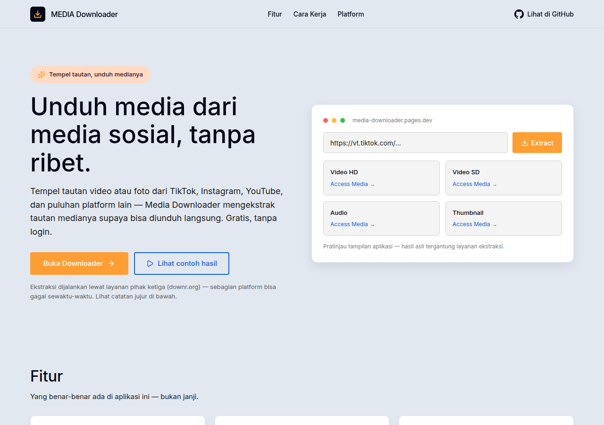
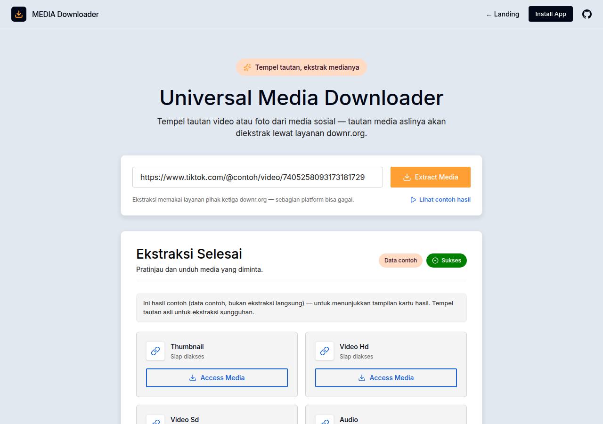

# Media Downloader

Tempel tautan video atau foto dari media sosial — tautan media aslinya diekstrak supaya bisa diunduh langsung. Gratis, tanpa login.

**Live:** https://unduh-media.pages.dev



## Demo

[](docs/demo.mp4)

Video demo (10 detik, **tanpa suara** — direkam headless): landing → buka downloader → contoh hasil ekstraksi. [Tonton langsung (mp4)](docs/demo.mp4)

## Cara memakai

1. Buka https://unduh-media.pages.dev
2. Klik **Buka Downloader** (kunjungan berikutnya langsung masuk aplikasi).
3. Tempel tautan video/foto — contoh: `https://vt.tiktok.com/…`
4. Klik **Extract Media**. Kartu hasil menampilkan setiap tautan media yang ditemukan — klik **Access Media** untuk membuka/mengunduhnya.
5. Belum yakin? Klik **Lihat contoh hasil** — tampilan kartu hasil dengan data contoh (diberi label jelas, bukan ekstraksi sungguhan).

## Yang benar-benar ada

- Ekstraksi tautan media dari puluhan platform (TikTok, Instagram, YouTube, Facebook, Threads, dan lainnya) lewat layanan downr.org.
- Pratinjau tautan hasil sebagai kartu, plus payload teknis mentah (bagian "Lihat Payload Teknis").
- Cache 10 menit: tautan yang sama tidak diekstrak ulang.
- Mode demo (data contoh berlabel) supaya tampilan hasil bisa dilihat tanpa menunggu layanan pihak ketiga.
- PWA: manifest + service worker, bisa di-install ke layar utama.
- Landing ala SaaS + logo GitHub di kanan atas yang mengarah ke repo ini.

## Catatan jujur

Media Downloader **bukan** layanan pengunduh itu sendiri. Ia meneruskan tautan ke **downr.org**, layanan pihak ketiga yang mengekstrak tautan media dari halaman platform. Proyek ini tidak mengontrol layanan itu, tidak menyimpan media, dan tidak menjamin semua tautan berhasil diekstrak. Daftar platform mengikuti klaim downr.org dan bisa berubah tanpa pemberitahuan.

Ekstraksi nyata **tidak bisa diverifikasi dari VM pengembangan** (permintaan POST ke downr.org menggantung dari jaringan egress VM — GET ke downr.org sendiri normal). Round-trip live perlu satu kali cek dari browser biasa: tempel tautan TikTok/YouTube asli di situs live dan pastikan kartu hasil terisi. Bila gagal, pesannya ditampilkan apa adanya.

Unduh hanya media yang memang boleh diunduh, dan hormati hak cipta pembuatnya.

## Menjalankan lokal

```bash
npm install
npm run dev        # http://localhost:3000
```

Perhatian: `npm run dev` tidak menyajikan `/api/download` — endpoint itu dijalankan oleh worker Cloudflare (`public/_worker.js`), bukan oleh Next.js. Untuk menguji alur error lokal, pakai skrip `diag/serve-md.mjs` (bukan bagian repo) atau langsung uji worker-nya:

```bash
npm run test:worker   # unit test worker edge (tanpa jaringan)
npm run build         # static export ke out/
npm run smoke         # cek hasil build
```

## Tech stack

- Next.js 15 (App Router) + React 19, static export (`output: 'export'`)
- Tailwind CSS 4
- Cloudflare Pages (direct upload) + Advanced-Mode worker (`public/_worker.js`) untuk `/api/download`
- CI: typecheck + lint + build, unit test worker, html-validate + link check + smoke

## Struktur

```
app/                  # layout + halaman (landing + aplikasi)
lib/demo-fixture.ts   # data contoh untuk mode demo (bukan hasil nyata)
public/_worker.js     # edge worker: proxy /api/download -> downr.org
public/sw.js          # service worker (cache aset statis, API selalu network)
public/manifest.json  # PWA manifest
scripts/smoke.mjs     # cek hasil build
scripts/test-worker.mjs  # unit test worker (fetch di-stub)
docs/                 # PRD, arsitektur, API, diagram, screenshot, video demo
```

Detail lengkap: [PRD](PRD.md) · [Arsitektur](docs/architecture.md) · [API](docs/api.md) · [Changelog](CHANGELOG.md)

## Lisensi

MIT — lihat [LICENSE](./LICENSE).
